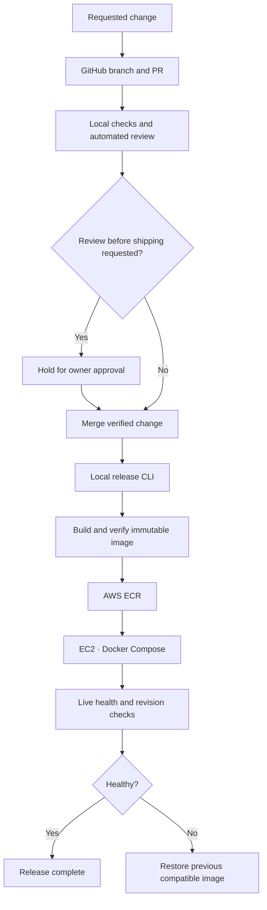

# handh.dev

## Website delivery

Bubba Website changes ship by default after successful local verification and automated review. “Let me review it before shipping” holds the change unmerged and undeployed until explicit approval. GitHub stores source and reviews; GitHub Actions is not part of this delivery path.

The project release command is `./project release --environment production`. Other services keep their own release procedures. See the [local SDLC specification](https://github.com/handh-dev/handh-dev/blob/main/docs/local-sdlc.md) for the workflow and measured acceptance.

## Repositories

| Repository | Purpose |
|---|---|
| [handh-dev](https://github.com/handh-dev/handh-dev) | Shared architecture and delivery policy |
| [handh-infra](https://github.com/handh-dev/handh-infra) | Rust operations/tooling, AWS, OpenTofu and shared hosting |
| [bubbas-mono](https://github.com/handh-dev/bubbas-mono) | Maintained Bubba applications and project-owned release tooling |
| [handh-website](https://github.com/handh-dev/handh-website) | Howeth and Harp website and HHQ |

## Infrastructure

Applications run in Docker Compose on EC2. PostgreSQL and application data use persistent EBS storage. Database backups go to encrypted S3; the additional in-house backup destination is planned.

Keep business functionality available through reusable application logic and APIs. Keep operational tooling local, portable and inexpensive.
